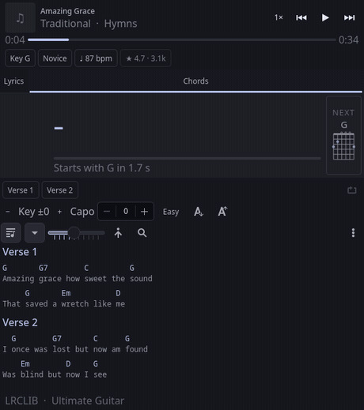

<p align="center"></p>

<h1 align="center">Chordist</h1>

<p align="center"><b>A guitar companion for KDE Plasma.</b><br>
The chords, tab, lyrics and fingerings for whatever you are playing, in step with the song.</p>

<p align="center">
<a href="https://gitlab.com/ritwick7/chordist/-/pipelines"></a>
<a href="LICENSE"></a>


</p>

<p align="center"></p>

Chordist listens to whatever is playing (Spotify, a browser tab, a phone over KDE Connect: anything that speaks
MPRIS) and puts the chords, tab, lyrics and fingerings in a panel popup, kept in step with the song. It is for
playing along, not for watching.

## What it does

- **The Stage.** The chord you should be playing right now, large, with its fingering, finger numbers, notes and
  place in the key (`I7`), and the next chord with a countdown, so your hand is already moving when it lands.
  The chord sounding now is marked on the chart too, and can show in the panel itself.
- **Capo calculator.** Says which capo turns a barre-chord song into open shapes and what you would be playing
  (`Easier: capo 3 → G D Em C`); one click applies it. Transpose, capo and "easy chords" all recompute at once.
- **Practice tools.** Jump to any section, loop the one you are learning, slow the player down (players that
  allow it), click any line to seek there, tap a chord to preview its fingering.
- **Real tabs.** Tablature is parsed into staves and re-flowed at its bar lines to fit the popup, with the tab's
  tuning, difficulty, tempo and rating shown as chips.
- **Real fingerings.** Several voicings per chord with finger numbers and barres from
  [chords-db](https://github.com/tombatossals/chords-db), plus Ultimate Guitar's own fingering for the chords on
  the tab you are reading. Mirror them for a left-handed player.
- **Synced lyrics** from [LRCLIB](https://lrclib.net), with word-level highlighting where it has it, and
  Devanagari lyrics romanised to match the chord sheets.
- **Yours first.** Paste a chart (Ultimate Guitar format, ChordPro or plain text) or an Ultimate Guitar address and
  it is saved for that song and always wins over the internet. Pick another version when the automatic one is
  wrong; transpose, capo and lyric timing are remembered per song.

| Ultimate Guitar tab with its metadata | Tablature | Lyrics |
| --- | --- | --- |
|  |  |  |

The pictures are headless renders against a fixture service (`make shots`), not photographs of a desktop.

## Install

Needs KDE Plasma 6 and Python 3.12+ (`make deps` tells you what your machine is missing and prints the install line
for Arch, Debian and Ubuntu, Fedora or openSUSE).

Tested range: Kirigami 6.13 to 6.31, Qt 6.8 to 6.12, Plasma 6.3 to 6.8, which covers Debian 13 and Ubuntu 25.04 at
the old end and Arch at the new. The widget reads the player through `org.kde.plasma.private.mpris`, a *private*
Plasma API: it is not covered by KDE's compatibility promises, so a future Plasma may need a release of Chordist
to follow it.

**Arch Linux**

```sh
git clone https://gitlab.com/ritwick7/chordist.git && cd chordist
make pkgbuild && cd build/pkg && makepkg -si
systemctl --user enable --now chordistd
systemctl --user restart plasma-plasmashell
```

**Any distribution, from the source tree** (installs into `~/.local`)

```sh
git clone https://gitlab.com/ritwick7/chordist.git && cd chordist
make deps        # what is missing, and the install line for your distribution
make install     # widget + service + systemd user unit; starts the service
systemctl --user restart plasma-plasmashell     # loads the widget
```

Then add **Chordist** to a panel and play something. `chordist doctor` shows what the service can and cannot do on
your machine. `make uninstall` removes the widget and service and leaves your charts and settings alone.

### Upgrading from the old "lyricist"

Before 2.0 this was called `lyricist`. `make install` moves the old service and your data (config, saved charts,
per-song settings, caches) to the new names. The widget is a different package, so your panel keeps pointing at the
old one until you run, once:

```sh
make migrate-panel      # stops plasmashell, repoints the panel entry, restarts it
```

It rewrites only the panel entry's `plugin=` line (with KDE's own `kwriteconfig6`, after a timestamped backup), so
the widget keeps its place and every setting, and then removes the old package. Both steps are safe to repeat. If you
installed the Arch package instead, run `make migrate` once from the checkout to move the old service and data.

## Using it

| Key | Does |
| --- | --- |
| `Space` | play / pause |
| `←` `→` | back / forward 5 s |
| `↑` `↓` | scroll the view |
| `[` `]` | transpose down / up |
| `L` | loop the current section |
| `Esc` | close the popup or window |

Click a chord name to see its fingering on the Stage, a lyric or chart line to seek there, a section chip to jump to
it, the big diagram to cycle through other fingerings. The `⋮` menu has the stage, fingering strip, finger numbers,
left-handed mode, romanising, **Ask again** and "open in a window". Settings (panel style, text size, opacity, default
tab, middle click) are in the widget's configuration dialog. Something not right?
[docs/troubleshooting.md](docs/troubleshooting.md).

## Configuration

The service reads `~/.config/chordist/config.json`; every key is optional, and only what you set is ever written
back. `chordist config` prints the effective values.

| Key | Default | |
| --- | --- | --- |
| `contact` | `""` | sent to LRCLIB so they can reach you if the client misbehaves; please set it |
| `port` / `host` | `8788` / `127.0.0.1` | the widget's address is a setting in its own dialog |
| `chords_sources` | `["local","cache","ultimate-guitar"]` | tried in order |
| `ug_enabled` | `true` | `false` makes it fully offline apart from lyrics |
| `romanise` | `"auto"` | `"always"`, `"never"` |
| `fingerprint_enabled` | `true` | identify a track from its audio when its metadata is junk, see [SECURITY.md](SECURITY.md) |
| `fingerprint_seconds` | `6` | how much audio to record for that, kept between 1 and 30 |
| `songrec_path` | `""` | the SongRec program, when it is not where Chordist looks (see below) |
| `min_request_interval` | `1.6` | seconds between requests to one host |
| `negative_ttl_seconds` / `lyrics_negative_ttl_seconds` | 3 days / 6 hours | how long "nothing found" is remembered (**Ask again** looks past it) |

Your own charts live in `~/.local/share/chordist/chords/` as ChordPro files; `chordist local list|add|rm` manages them.

### Identifying a song from its audio (SongRec)

When a player's title and artist cannot be matched, Chordist records a few seconds of what is playing (`pw-record` and
`pactl`, from PipeWire and PulseAudio's tools) and asks [SongRec](https://github.com/marin-m/SongRec). SongRec is
optional and a separate program. Arch packages it (`pacman -S songrec`). Debian, Ubuntu, Fedora and openSUSE do not;
follow its [installation instructions](https://github.com/marin-m/SongRec#installation) (building it with
`cargo install songrec` puts it in `~/.cargo/bin`). Chordist looks for `songrec` on `PATH`, then in `~/.cargo/bin`
and `~/.local/bin` (a service started by systemd has a short `PATH`). If it lives somewhere else, give its full path
in `~/.config/chordist/config.json`:

```json
{ "songrec_path": "/opt/songrec/bin/songrec" }
```

`chordist doctor` prints the path it settled on, or says it found none.

## Privacy

Looking a song up sends its artist and title to LRCLIB and Ultimate Guitar. If `fingerprint_enabled` is on and a
track's metadata cannot be matched, a few seconds of the audio playing on your default output are recorded and
identified by SongRec (Shazam's service). Both are described, with the switches, in [SECURITY.md](SECURITY.md).
Nothing else leaves the machine; the service listens on loopback only and refuses requests from web pages.

## Legal

Chordist is an independent, unofficial project. It is not affiliated with, endorsed by or sponsored by Ultimate
Guitar, Shazam/Apple, LRCLIB or KDE; those names belong to their owners
([THIRD-PARTY-NOTICES.md](THIRD-PARTY-NOTICES.md)).

Charts and tabs belong to their authors and to the sites that host them. Chordist reads Ultimate Guitar's public
pages on your behalf, one request at a time, paced (`min_request_interval`) and cached on your machine, and does not
redistribute anything. Whether that is acceptable under that site's terms where you live is your call and your
responsibility: `"ug_enabled": false` turns it off and leaves lyrics (LRCLIB) and your own charts.

## Known limits

- Plasma 6 on Linux only; the player has to speak MPRIS.
- The chart follows the *lyrics'* timings. A song with no synced lyrics gets its chart spread evenly over its length,
  and a tab (which has no timing at all) is followed by the reading scroll, not by the music.
- Ultimate Guitar is scraped, so a change to its pages can break chart lookup until the parser is updated. Lyrics
  and your own charts do not depend on it.
- The strumming pattern is not drawn (Ultimate Guitar stores it in a private code); only its tempo is used.
- The interface is in English; the strings are wrapped for translation but no translations exist yet.
- Wayland cannot let an application keep itself above other windows, so the floating window is only kept on top
  under X11; under Wayland use KWin's "Keep above" (the window's title-bar menu).
- If `systemctl --user status chordistd` says `status=226/NAMESPACE`, the kernel does not allow unprivileged user
  namespaces and the unit's sandbox cannot start: see [docs/troubleshooting.md](docs/troubleshooting.md).

## Built on

Free software, used as it is rather than reimplemented:

| | |
| --- | --- |
| [KDE Plasma](https://kde.org/plasma-desktop/), [Kirigami](https://develop.kde.org/frameworks/kirigami/), Qt | the widget, its chips, toolbars, tabs and MPRIS bridge |
| [chords-db](https://github.com/tombatossals/chords-db) (MIT) | guitar fingerings, vendored in `chordist/data` |
| [LRCLIB](https://lrclib.net) | synced lyrics |
| [SongRec](https://github.com/marin-m/SongRec) (GPL-3.0) | audio identification, run as a separate program |
| [Ultimate Guitar](https://www.ultimate-guitar.com) | chord charts and tabs, fetched politely and cached |
| [uv](https://docs.astral.sh/uv/), [pytest](https://pytest.org), [ruff](https://docs.astral.sh/ruff/), [vulture](https://github.com/jendrikseipp/vulture), [REUSE](https://reuse.software) | development |

The service itself has no Python dependencies beyond the standard library, which keeps a login daemon small and
makes installing it a file copy. The hand-written parts are the parts nobody ships: parsing chord charts and tab,
aligning a chart to timed lyrics, and the music theory behind the capo calculator.

## Contributing

Development happens on [GitLab](https://gitlab.com/ritwick7/chordist); [GitHub](https://github.com/RitwickVerma/chordist) is a mirror. Issues are welcome on either, merge
requests on GitLab. [CONTRIBUTING.md](CONTRIBUTING.md) has the bar a change has to clear (short version: run it,
do not just read it) and [CODE_OF_CONDUCT.md](CODE_OF_CONDUCT.md) the ground rules.

```sh
make test        # pytest, node --test, qmltestrunner
make lint        # reuse, ruff, vulture, qmllint, shellcheck
make shots       # render the widget headless into build/shots
make coverage    # Python coverage, with the lines no test reaches
```

[AGENTS.md](AGENTS.md) is the working guide, [docs/architecture.md](docs/architecture.md) explains the shape of it
and why, [docs/api.md](docs/api.md) lists the service's HTTP API, [docs/testing.md](docs/testing.md) the four layers
of testing, [docs/releasing.md](docs/releasing.md) how a release is cut. Security problems go through
[SECURITY.md](SECURITY.md), not public issues.

## Licence

MIT, see [LICENSE](LICENSE). The vendored chord database is MIT too, (c) 2016 David Rubert
([chordist/data/LICENSE.chords-db](chordist/data/LICENSE.chords-db)).
