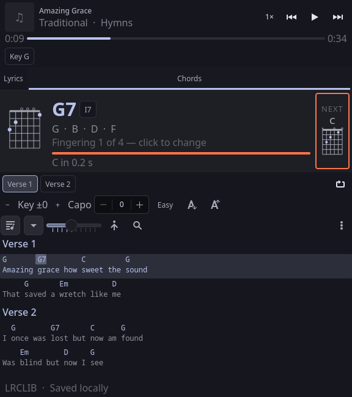
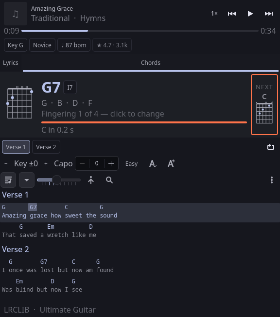
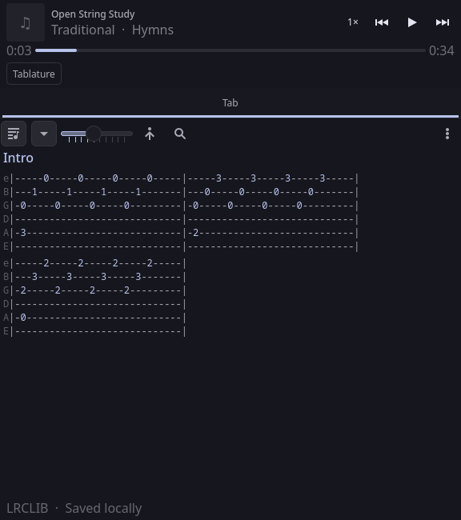
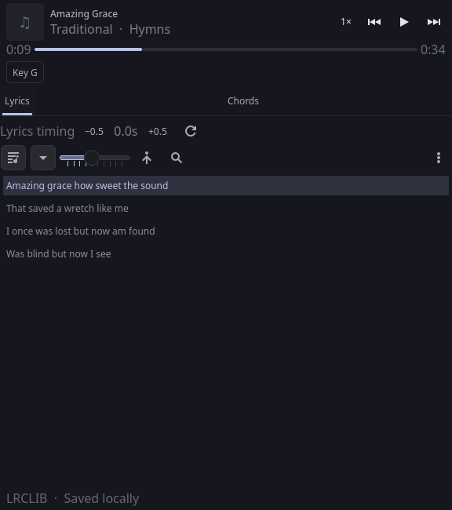

# Chordist

**A guitar companion for KDE Plasma.** It listens to whatever is playing (Spotify, a browser tab, a phone over
KDE Connect: anything that speaks MPRIS) and puts the chords, tab, lyrics and fingerings in a panel popup, kept
in step with the song.



- **The Stage.** The chord you should be playing right now, large, with its fingering, finger numbers, notes and
  place in the key (`I7`), and the next chord with a countdown, so your hand is already moving when it lands.
  The chord sounding now is marked on the chart too, and can show in the panel itself.
- **Capo calculator.** Says which capo turns a barre-chord song into open shapes and what you would be playing
  (`Easier: capo 3 → G D Em C`); one click applies it. Transpose, capo and "easy chords" all recompute at once.
- **Practice tools.** Jump to any section, loop the one you are learning, slow the player down (players that
  allow it), click any line to seek there.
- **Real tabs.** Tablature is parsed into staves and re-flowed at its bar lines to fit the popup, with the tab's
  tuning, difficulty, tempo and rating shown as chips.
- **Real fingerings.** Several voicings per chord with finger numbers and barres from
  [chords-db](https://github.com/tombatossals/chords-db), plus Ultimate Guitar's own fingering for the chords on
  the tab you are reading. Mirror them for a left-handed player.
- **Synced lyrics** from [LRCLIB](https://lrclib.net), with word-level highlighting where it has it, and
  Devanagari lyrics romanised to match the chord sheets.
- **Yours first.** Paste a chart (Ultimate Guitar format, ChordPro or plain text) or an Ultimate Guitar address and
  it is saved for that song and always wins over the internet. Pick another version when the automatic one is
  wrong; transpose, capo and lyric timing are remembered per song.

| Ultimate Guitar tab with its metadata | Tablature | Lyrics |
| --- | --- | --- |
|  |  |  |

The pictures are headless renders against a fixture service (`make shots`), not photographs of a desktop.

## Install

Needs Plasma 6, Python 3.12+ and `kpackagetool6`.

```sh
git clone https://gitlab.com/ritwick7/chordify.git && cd chordify
make deps        # what is missing, and the pacman line to fix it
make install     # widget + service + systemd user unit, into ~/.local; starts the service
systemctl --user restart plasma-plasmashell     # loads the widget
```

Add **Chordist** to a panel. Then `make doctor` shows what the service can and cannot do on your machine.
`make uninstall` removes the widget and service and leaves your charts and settings alone.

## Using it

| Key | Does |
| --- | --- |
| `Space` | play / pause |
| `←` `→` | back / forward 5 s |
| `↑` `↓` | scroll the view |
| `[` `]` | transpose down / up |
| `L` | loop the current section |
| `Esc` | close the popup or window |

Click a chord name to find its diagram, a lyric or chart line to seek there, a section chip to jump to it. Click the
big diagram to cycle through other fingerings. The `⋮` menu has the stage, fingering strip, finger numbers,
left-handed mode, romanising and "open in a window". Settings (panel style, text size, opacity, default tab, middle
click) are in the widget's configuration dialog.

## Configuration

The service reads `~/.config/chordist/config.json`; every key is optional. `chordist config` prints the effective
values.

| Key | Default | |
| --- | --- | --- |
| `contact` | `""` | sent to LRCLIB so they can reach you if the client misbehaves; please set it |
| `port` / `host` | `8788` / `127.0.0.1` | the widget's address is a setting in its own dialog |
| `chords_sources` | `["local","cache","ultimate-guitar"]` | tried in order |
| `ug_enabled` | `true` | `false` makes it fully offline apart from lyrics |
| `romanise` | `"auto"` | `"always"`, `"never"` |
| `fingerprint_enabled` | `true` | identify a track from its audio when its metadata is junk, see [SECURITY.md](SECURITY.md) |
| `min_request_interval` | `1.6` | seconds between requests to one host |
| `negative_ttl_seconds` / `lyrics_negative_ttl_seconds` | 3 days / 6 hours | how long "nothing found" is remembered (the `⋮` menu's **Ask again** looks past it) |

Your own charts live in `~/.local/share/chordist/chords/` as ChordPro files; `chordist local list|add|rm` manages them.

## Privacy

Looking a song up sends its artist and title to LRCLIB and Ultimate Guitar. If `fingerprint_enabled` is on and a
track's metadata cannot be matched, a few seconds of the audio playing on your default output are recorded and
identified by SongRec (Shazam's service). Both are described, with the switches, in [SECURITY.md](SECURITY.md).
Nothing else leaves the machine; the service listens on loopback only and refuses requests from web pages.

## Built on

Free software, used as it is rather than reimplemented:

| | |
| --- | --- |
| [KDE Plasma](https://kde.org/plasma-desktop/), [Kirigami](https://develop.kde.org/frameworks/kirigami/), Qt | the widget, its chips, toolbars, tabs and MPRIS bridge |
| [chords-db](https://github.com/tombatossals/chords-db) (MIT) | guitar fingerings, vendored in `chordist/data` |
| [LRCLIB](https://lrclib.net) | synced lyrics |
| [SongRec](https://github.com/marin-m/SongRec) (GPL-3.0) | audio identification, run as a separate program |
| [Ultimate Guitar](https://www.ultimate-guitar.com) | chord charts and tabs, fetched politely and cached |
| [uv](https://docs.astral.sh/uv/), [pytest](https://pytest.org), [ruff](https://docs.astral.sh/ruff/), [vulture](https://github.com/jendrikseipp/vulture), [REUSE](https://reuse.software) | development |

The service itself has no Python dependencies beyond the standard library, which keeps a login daemon small and
makes installing it a file copy. The hand-written parts are the parts nobody ships: parsing chord charts and tab,
aligning a chart to timed lyrics, and the music theory behind the capo calculator.

## Development

```sh
make test        # pytest, node --test, qmltestrunner
make lint        # reuse, ruff, vulture, qmllint, shellcheck
make shots       # render the widget headless into build/shots
```

[AGENTS.md](AGENTS.md) is the working guide, [docs/architecture.md](docs/architecture.md) explains the shape of it
and why, [docs/api.md](docs/api.md) lists the service's HTTP API, [CONTRIBUTING.md](CONTRIBUTING.md) the bar for a
change.

Everything is called Chordist: the widget (`com.ritwick.chordist`), the service (`chordistd`), the CLI (`chordist`),
the Python package and `~/.config|.local/share|.cache/chordist`. Before 2.0 it was all called `lyricist`; see below.

## Upgrading from the old "lyricist"

`make install` does the move for you: it stops and removes the old `lyricistd` service, moves your config, saved
charts, per-song settings and caches to the new `chordist` directories, and starts the new service. The widget itself
is a different package now, so your panel still points at the old one until you run, once:

```sh
make migrate-panel      # stops plasmashell, repoints the panel entry, restarts it
```

That rewrites only the panel entry's `plugin=` line (with KDE's own `kwriteconfig6`, after a timestamped backup), so
the widget keeps its place in the panel and every setting, and then removes the old widget package. Both steps are
safe to run again.

## Licence

MIT, see [LICENSES/MIT.txt](LICENSES/MIT.txt). The vendored chord database is MIT too, (c) 2016 David Rubert.
